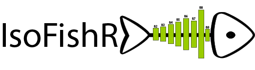

# IsoFishR 2 (development version)

Data reduction and analysis of <sup>87</sup>Sr/<sup>86</sup>Sr ratios measured by laser-ablation MC-ICP-MS, for example along otolith transects. IsoFishR turns instrument runfiles into blank-corrected, Rb-interference- and mass-bias-corrected profiles. You then trim them, mark regions, detect changepoints and export the results, all in an app that runs in your browser.

> **Looking for the original IsoFishR (v1)?** It is still available as the [v1.1 release](https://github.com/MalteWillmes/IsoFishR/releases/tag/v1.1), as described in [Willmes et al. 2018, PLOS ONE](https://journals.plos.org/plosone/article?id=10.1371/journal.pone.0204519).

## Installation

You need [R](https://cloud.r-project.org/) (4.1 or newer). [RStudio](https://posit.co/download/rstudio-desktop/) is optional. In R, run:

```r
install.packages("IsoFishR", repos = c("https://maltewillmes.r-universe.dev", "https://cloud.r-project.org"))
```

Run the same line again to update. No extra build tools are needed on Windows, macOS or Linux.

## Start the app

```r
IsoFishR::run_app()
```

The app opens in your web browser. To stop it, click **Quit IsoFishR** (top right). If you close or reload the tab instead, the browser asks first; a closed tab stops the app after a few seconds.

## The six steps

The app guides you through a project from left to right. **Quit IsoFishR** and the **Change log** are always at the top right. Everything is saved as you work, and a project reopens on the step you last worked on.

1. **Project.** Create a new project (a folder you choose, e.g. in Dropbox or on a shared drive) or open an existing one; recent projects are listed. Pick the instrument preset when creating a project.
2. **Settings.** Check the runfile layout first.
   - **Instrument preset:** `Nu_UCDavis` (Nu Plasma) is built in. For another instrument, set the layout, test it with **Check the layout with a runfile**, and save it as a preset to reuse it.
   - **Reduction defaults:** run speed, integration, blank time, 88Sr limits, outlier rejection and smoothing.
3. **Runfiles.** Add runfiles as individual files, or choose a folder: all files with the preset's extension (`.run`) in it and its subfolders are found.
   - **More batches:** you can add more at any time.
   - **Same name as an existing run:** choose whether to keep the existing run or replace it with the new file. Replaced runs keep their edits, regions and notes.
   - **Runs table:** lists all runs in acquisition order (read from the runfile timestamps), and lets you remove runs.
4. **Calibration.** Correct the samples to a reference material measured in the same session, in the style of Iolite.
   - **SBO suggestion:** runs with *SBO* in their name are suggested as the primary reference material, with an accepted value of 0.70918 that you can change.
   - **Other reference materials:** add them with their accepted value and ± 2σ, then mark their runs under *Assign runs*. Runs can also be marked as baselines (gas blanks).
   - **Primary vs secondary:** the primary reference material corrects the samples. By default this is a linear regression of its run means against time, within each analytical session. A new session starts after a gap of more than 6 hours, and runs can be moved between sessions. The correction is applied to every point at the time it was measured. Other fits are available under *Advanced*. All other reference materials are secondary: they are corrected like samples and reported per session as accuracy checks.
   - **The plot:** each reference material's run means before and after correction, the regression line, the accepted values and the secondary session averages.
   - **The table:** uncorrected and corrected mean and SD per reference material and session, with the deviation from the accepted value.
5. **Workspace.** Large plots of <sup>87</sup>Sr/<sup>86</sup>Sr, total Sr, <sup>83</sup>Kr and <sup>85</sup>Rb/<sup>88</sup>Sr for each sample. A badge shows whether the values are corrected to the reference material or uncorrected. When the calibration changes, the plots update.
   - **Selecting a range:** drag across the plot. The footer shows the range's mean ± 2 SE.
   - **Edit:** trim, add the selection as a named region, reverse the profile, or detect changepoints.
   - **Reduction:** change settings for one sample only.
   - **Notes:** status, flag and comment. "Mark reviewed and go to next" steps through the samples.
6. **Export.** Choose the files to write. They go to a new dated folder inside the project; earlier exports are kept.

Each sample keeps its own SE. The uncertainty of the correction, from the primary measurements and the accepted value, is reported separately and in a combined SE. Without a primary reference material, all values stay uncorrected.

To try IsoFishR without your own data, add the example runfiles that come with it (five Chinook salmon otoliths and one white seabass otolith). Find their folder with `system.file("extdata", "runfiles", package = "IsoFishR")`.

### What is in a project folder

```
MyProject/
  project.yml   project settings, including the import preset
  raw/          copies of the original runfiles (never changed)
  samples.csv   per run: type, acquisition time, session, status, flag, comment, trims, setting overrides
  regions.csv   regions per sample
  reference_materials.csv   reference materials with accepted values
  log.csv       every change: when, who, what, old and new value
  cache/        reduced data (safe to delete; rebuilt automatically)
  exports/      one dated folder per export
  app_state.yml the step the project was last worked on
```

Projects can be shared by sharing the folder. Only one person can edit a project at a time; others can open it read-only.

### Exports

Each export creates `exports/<date_time>/` containing:

| File | Contents |
|---|---|
| `profiles.csv` | Every point of every profile in one table: distance, time, <sup>87</sup>Sr/<sup>86</sup>Sr, smoothed value and SE, region, changepoint segment, and signal intensities |
| `samples.csv` | One row per sample: type, session, status, comment, edits, profile mean, SD and SE (and, when corrected, the uncorrected mean, correction factor and combined SE) |
| `regions.csv` | One row per sample and region: mean, SD, n, SE, distance range |
| `changepoints.csv` | One row per changepoint segment |
| `runs.csv` | All runs in acquisition order with type and session |
| `reference_materials.csv` | Every reference material run: measured and corrected mean, deviation from the accepted value (ppm), whether it is within uncertainty |
| `reference_material_summary.csv` | Per reference material and session: runs, mean, 2 SD, deviation |
| `settings.csv` | Every setting each sample was reduced with, including the calibration |
| `export_info.yml` | Always written: a full record of the export. Date, user and IsoFishR version; runs and sessions; the calibration method and baseline mode; the primary and each secondary reference material with accepted value, number of runs and mean and SD before and after correction (overall and per session); all project settings; and per-sample setting overrides |

## Using IsoFishR from R code

All of the app's functions are available in R scripts, for example:

```r
library(IsoFishR)
p <- create_example_project()
p <- set_regions(p, "PC_2016_01_A2_4R",
                 data.frame(region = "core", start_s = 200, end_s = 260))
summarise_project_regions(p)
export_project(p)
close_project(p)
```

## What changed from v1

- **One workspace:** data reduction and analysis share a single screen, and you can move back and forth freely.
- **Non-destructive edits:** trims, regions and setting changes are stored as choices, not baked into the data, so they can always be undone or changed.
- **Change log:** every choice is recorded in the project's change log.
- **Projects anywhere:** projects live in any folder, not inside the app.
- **Faster:** reduction is several times faster, and only samples whose data or settings changed are reprocessed.
- **v1 bugs fixed:**
  - Integration blocks no longer span two runfiles.
  - The right-hand trim no longer applies to every sample.
  - Changepoint means are no longer pooled across samples.
  - Spline smoothing now works.
  - The moving-average SE now uses the points actually in each window.
- **SE from individual points:** region and sample statistics are calculated from the individual points rather than smoothed values, so the reported SE is no longer underestimated.
- **No PDF plots:** per-sample PDF plots are no longer produced. Summaries and full profiles are exported as CSV instead.

Details are in [`dev/DESIGN.md`](dev/DESIGN.md).

## Citation

Willmes M, Ransom KM, Lewis LS, Denney CT, Glessner JJG, Hobbs JA (2018). IsoFishR: An application for reproducible data reduction and analysis of strontium isotope ratios (<sup>87</sup>Sr/<sup>86</sup>Sr) obtained via laser-ablation MC-ICP-MS. *PLOS ONE* 13(9): e0204519. https://doi.org/10.1371/journal.pone.0204519

## License

MIT. Questions and bug reports: [GitHub issues](https://github.com/MalteWillmes/IsoFishR/issues).
